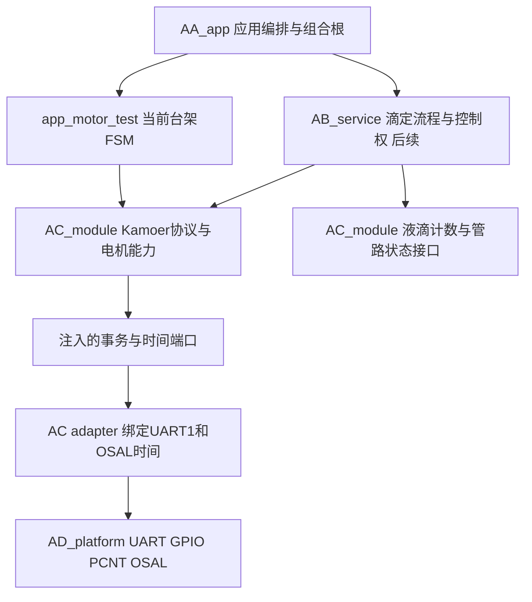

# fish_bin 工程大纲与第一阶段边界

更新日期：2026-11-13。
工程：`/home/crowiehuang/Project/ESP32Project/fish_bin`。

2026-11-14：第二阶段已接入 GPIO4 的 PCNT 只读台架测试，接线及操作见
[液滴计数台架说明](drop_count_bringup.md)。下文保留第一阶段实施范围。

第三阶段：已接入 `AB_service/dosing`。清水联调流程与结果说明见
[滴定服务台架](dosing_bringup.md)，默认保留计数模式。

## 已确认需求

- ESP32-S3，ESP-IDF v6.1，FreeRTOS；保持现有SDK、sdkconfig与工程命名。
- 单路Kamoer 4460.5步进驱动板驱动蠕动泵，以RS485通讯；外部模块自动收发，MCU侧使用普通UART。
- QLT1616为独立计数传感器，采集实际液滴；不是QLX72仪表，不需要实现其485协议。
- OGR350气泡传感器用于判断软管有液/无液，当前仍测试，本期只预留接口。
- 最终药量以有效的液滴计数和实测标定值计算。电机速度/位置脉冲用于泵运行控制和诊断，不作为已送达药量证明。

## 架构与封装

| 层 | 职责及本期状态 |
| --- | --- |
| AA_app | 组合根、统一任务注册、台架测试。已接入单一bootstrap所有者，每100ms调度一次；超期重新锚定，避免追赶。 |
| AB_service | 后续实现`service_dosing`，管理泵控制权、目标滴数、计数基准、气泡/无滴超时、取消与最终结果。本期不创建空服务。 |
| AC_module | 已实现Kamoer 4460.5纯协议驱动和UART适配器；预留带valid与时间戳的传感输入契约。 |
| AD_platform | 已有UART、GPIO和OSAL；新增有界短帧FIFO发送入口。后续在此实现PCNT/中断采集，驱动不直接包含ESP-IDF头。 |
| AE_common | 统一错误身份、中文说明、首错与底层原因/位置；已有错误ABI不改。 |
| AF_config | 板级引脚在board_config；设备地址/总线在motor_config；台架动作在motor_test_config。后续增加独立标定和业务控制配置。 |

驱动持有实例及类型化`exchange/now_ms/context`接口，CRC、字节序和应答语义归驱动；硬件串口操作和RTU静默间隔归adapter。当前没有为同签名转发增加wrapper/handler；出现多种泵或统一能力需求时再增加电机wrapper。

本期应用只有台架测试，直接调用设备驱动。后续正式滴定由service独占设备，台架入口与业务入口必须互斥，不能再启动一个任务同时控制UART1。

## 第一阶段已实现

- 默认9600bps、8N1、从站1，禁止广播运动。
- 0x05：停车/启动线圈0x0001、方向0x0002、速度模式0x0003。
- 0x10：起始速度0x4007/0x4008、运行速度0x4009/0x400A；单位0.01rpm，32位高字在先。
- 0x04：从0x3001一次读取8个输入寄存器，得到驱动板报告的速度、位置脉冲、固件/硬件版本和序列号。
- CRC16/MODBUS、精确长度/字节数、设备地址、功能码、写应答回显和Modbus异常检查。
- 写请求应答超时、CRC/格式不正确时报告`FW_ERR_KAMOER_EXECUTION_UNKNOWN`；记录具体cause，不自动重复START。
- FAULT保留第一条错误的阶段、请求ID、时间、文件/函数/行号和底层origin；显式STOP可在FAULT尝试，清理失败另记。
- 应用按“探测→STOP→方向→模式→起始速度→运行速度→START→监控→STOP”执行；任一失败进入FAULT并额外尝试一次STOP。
- `APP_MOTOR_TEST_ENABLE=0`为交付默认值。初始化只绑定设备，不发电机总线命令。

位置模式暂未实现。手册目标位置增量标为uint32，但地址只列0x400F；需厂家确认是否占0x400F/0x4010，以及触发/完成语义。其他参数不写Flash、不改设备地址/波特率、不触发恢复默认值。

## 传感器边界

预留头文件：`AC_module/dosing_inputs/wrapper/inc/bsp_wrapper_dosing_inputs.h`。

该契约提供管路`UNKNOWN/PRESENT/ABSENT`、`liquid_valid`、`drop_count`、`count_valid`和采样时间；未绑定时`read_snapshot=NULL`，未来服务必须返回未就绪，不能把空提供者当作有药或零滴的有效样本。本期没有安装计数ISR/PCNT或气泡校准逻辑。

QLT1616后续优先用ESP32-S3 PCNT或短ISR累计边沿，在任务侧读一致快照；脉冲滤波、有效边沿、NPN/PNP、常开/常闭、计数溢出与传感器输出延迟需根据实物配置。不能用当前100ms应用周期轮询GPIO来计数。QLT手册标注最大1000次/秒，但默认10ms输出延时会限制实际高速计数，需随实验确认。

OGR350说明给出逻辑A用于非透明介质、逻辑B用于透明介质，且要求先对空管校准。说明未明确供电范围、输出电气类型和有效极性，先保留GPIO5候选输入，暂不启用。

## 正式滴定的下一阶段

建议业务状态：空闲→条件检查→泵运行→达到目标后停车→核对尾滴→完成；另外独立表达取消、故障和结果未知。

每次请求记录request_id、目标滴数、起始累计滴数和标定版本。运行中检查有效计数、无滴超时、最长运行时间和有效的气泡输入；气泡接口未接入时明确禁止依赖该保护的正式流程，台架测试则保持独立。

先以“滴”为控制单位，再用量筒/称重实测各药液、管路和速度下的每滴体积，得出标定系数。停车后的管路弹性、减速及尾滴需要实测补偿；STOP的ACK不等于轴已静止，更不等于滴定完成。

断电/重启恢复策略、定时投药、持久化参数、联网和人机界面尚未指定，不在本期擅自扩展。

## 资料依据

- `/home/crowiehuang/桌面/fish_bin/RS485.pdf`：Kamoer 4460.5 V1.3，PDF第5页拨码/接线、第6页通讯参数、第7至9页寄存器与示例。该文件文本层不可用，已渲染逐页核对。
- `/home/crowiehuang/桌面/fish_bin/QILY齐力达..V6.pdf`：第3至6页QLT型号参数、接线和设定；QLX72部分不适用于当前已确认的硬件。
- `/home/crowiehuang/桌面/fish_bin/OGR350气..1).pdf`：1页，接线、通道选择及空管校准。
- 工程根AGENTS及`.agents/skills/embedded-architecture/SKILL.md`：沿用已有分层与编码规范，本期未重新安装或重排工程。
